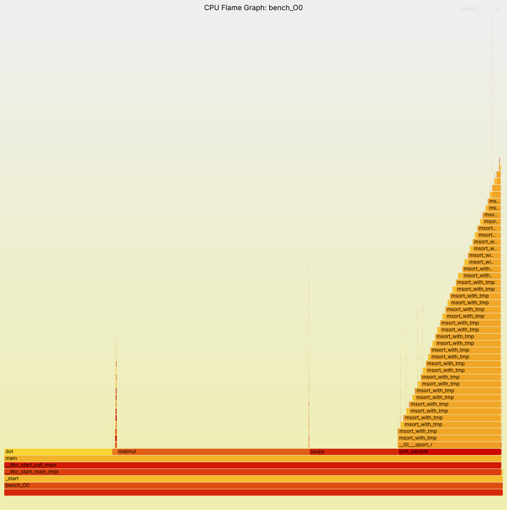
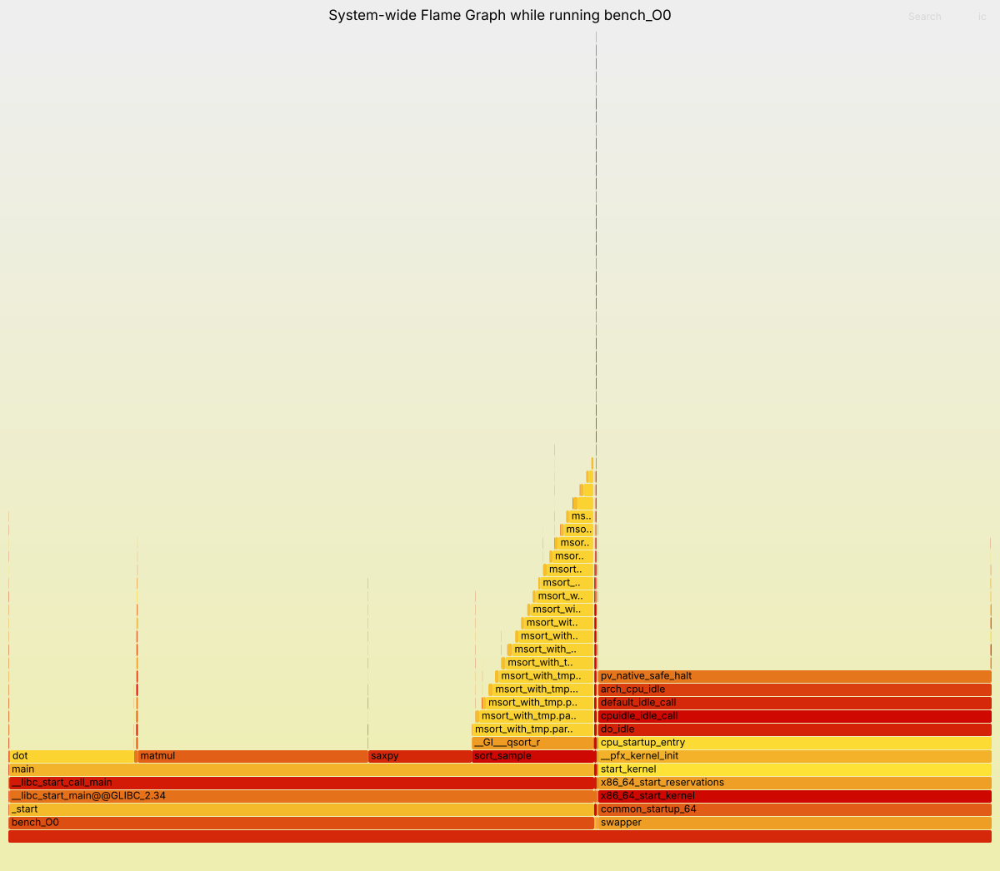
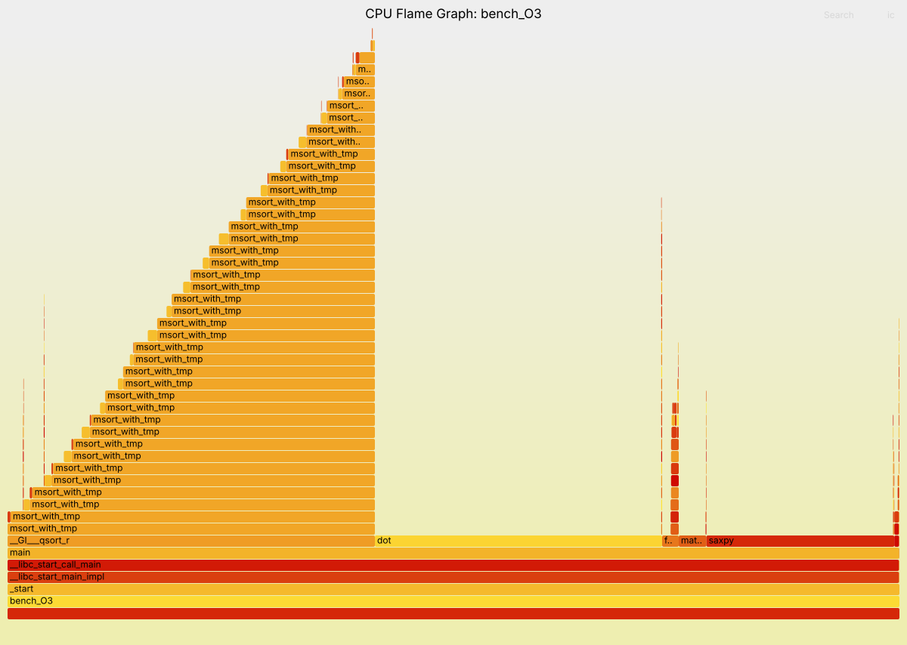
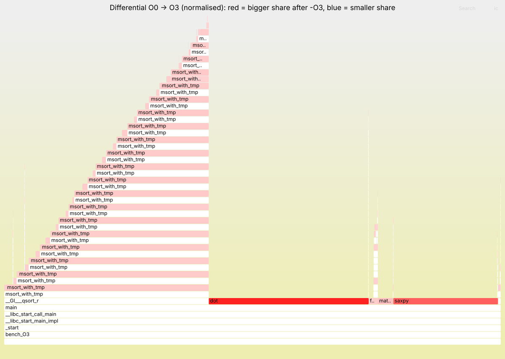

# Lab 2. Performance Measurement and Analysis

Досліджувана програма: [`src/bench.c`](src/bench.c) — невеликий обчислювальний бенчмарк на C із п'яти етапів:

| функція | що робить | характер навантаження |
|---|---|---|
| `fill` | заповнює масиви псевдовипадковими числами (LCG) | послідовна залежність між ітераціями |
| `matmul` | множення матриць 512×512 (порядок циклів i-k-j) | обчислювальне (compute-bound) |
| `saxpy` | `y = a·x + y` для 4 млн елементів, 20 разів | обмежене пропускною здатністю пам'яті (memory-bound) |
| `dot` | скалярний добуток, 20 разів | редукція (сума з залежністю) |
| `sort_sample` | `qsort` 1 млн чисел із власним компаратором | бібліотечний код + виклики через вказівник |

Програма друкує час кожного етапу і контрольну суму (щоб компілятор не викинув обчислення).

Дві збірки (див. [`Makefile`](Makefile)):

* `bench_O0` — `gcc -O0 -g -fno-omit-frame-pointer` — без оптимізацій;
* `bench_O3` — `gcc -O3 -mavx2 -mfma -g -fno-omit-frame-pointer` — максимальна оптимізація + AVX2/FMA (SIMD).

Функції позначені `noinline`, щоб і після `-O3` їх було видно окремо на FlameGraph та в `perf report`.

## Як відтворити

Linux-частина (perf, FlameGraph, time) — у GitHub Codespaces (`Code → Codespaces → Create codespace`), середовище налаштовується автоматично з `.devcontainer/`:

```bash
bash scripts/run_all.sh
```

Скрипт збирає обидві версії, знімає статистику, будує FlameGraph-и та порівняння. Окремі кроки:

```bash
make all asm
bash scripts/stats.sh build/bench_O0
bash scripts/flamegraph.sh build/bench_O0
bash scripts/flamegraph_system.sh build/bench_O0
bash scripts/flamegraph_diff.sh
bash scripts/compare.sh
```

Енергоспоживання — на macOS (Apple Silicon), бо там є доступ до реальних датчиків потужності:

```bash
xcode-select --install
make
sudo python3 energy/measure_mac.py build/bench_O0 build/bench_O3
```

## 1. FlameGraph

Побудова (за інструкцією Brendan Gregg):

```bash
sudo perf record -F 999 --call-graph dwarf -o /tmp/bench_O0.data -- build/bench_O0
sudo perf script -i /tmp/bench_O0.data > /tmp/bench_O0.perf
./FlameGraph/stackcollapse-perf.pl /tmp/bench_O0.perf > out.folded
./FlameGraph/flamegraph.pl out.folded > flamegraph.svg
```

1. `perf record` 999 разів на секунду зупиняє програму і записує поточний стек викликів (`--call-graph dwarf` — розкручування стеку за налагоджувальною інформацією DWARF).
2. `perf script` перетворює бінарний `perf.data` на текстові стеки.
3. `stackcollapse-perf.pl` згортає однакові стеки в один рядок `main;matmul 2290` (стек;кількість семплів).
4. `flamegraph.pl` малює SVG.



Інтерактивна версія: [results/bench_O0/flamegraph.svg](results/bench_O0/flamegraph.svg).

**Як читати:** вісь Y — глибина стеку (знизу `_start → main`, вище — викликані функції). Ширина прямокутника — частка часу CPU, коли ця функція була в стеку. Вісь X — це не час, а алфавітне сортування. Кольори випадкові (теплі відтінки = user-space код).

**Інтерпретація для `-O0`:**

* `matmul` займає ~40% — найбільше «плато», головний кандидат на оптимізацію;
* `dot` ~22%, `saxpy` ~17%;
* `sort_sample` ~20%: над ним висока «вежа» з `qsort_r → msort_with_tmp → msort_with_tmp …` — це рекурсія сортування злиттям у glibc (глибина ≈ log₂(10⁶) ≈ 20), на верхівках — наш компаратор `cmp`;
* `fill` — вузька смужка (<1%), її оптимізувати немає сенсу.

**Вся система** (`perf record -a`, [results/system/flamegraph.svg](results/system/flamegraph.svg)): ~60% семплів — `bench_O0`, ~40% — `swapper` (idle-потік ядра, `cpu_idle → pv_native_safe_halt`). Машина має 2 ядра, програма однопотокова, тому одне ядро зайняте, а друге простоює.



## 2. Статистика виконання

### 2.1 `/usr/bin/time --verbose`

Повний вивід: [O0](results/bench_O0/time_verbose.txt), [O3](results/bench_O3/time_verbose.txt).

| показник | O0 | O3 | що означає |
|---|---|---|---|
| Elapsed (wall clock) | 5.67 s | 1.82 s | реальний час від запуску до завершення |
| User time | 5.51 s | 1.72 s | час CPU у режимі користувача (наш код) |
| System time | 0.04 s | 0.03 s | час у ядрі (виділення пам'яті, page faults) |
| Percent of CPU | 97% | 96% | user+sys / wall — програма майже весь час працює на CPU |
| Maximum resident set size | 45.7 MB | 45.8 MB | пікова фізична пам'ять: 3 матриці по 1 МБ + 2 масиви по 16 МБ + 4 МБ ≈ 43 МБ + бібліотеки |
| Minor page faults | 12 115 | 12 114 | перше звернення до сторінок 4 КБ (≈45 МБ / 4 КБ) — без читання з диска |
| Major page faults | 0 | 0 | читання з диска не було |
| Voluntary / involuntary context switches | 1 / 15 | 1 / 9 | програма не чекає I/O; витіснення планувальником |

Висновок: програма CPU-bound, пам'ять та page faults від оптимізації не залежать (ті самі масиви), змінюється тільки user time.

### 2.2 `perf stat -d`

[O0](results/bench_O0/perf_stat.txt), [O3](results/bench_O3/perf_stat.txt)

| подія | O0 | O3 |
|---|---|---|
| task-clock | 6 132 ms | 1 883 ms |
| CPUs utilized | 0.999 | 0.998 |
| context-switches | 35 | 15 |
| cpu-migrations | 10 | 0 |
| page-faults | 12 096 | 12 096 |

* `task-clock` — скільки часу CPU витратив на задачу; «CPUs utilized ≈ 1» підтверджує, що програма однопотокова.
* `-d` додає L1-dcache і LLC (last-level cache) події, а також `cycles`, `instructions`, `branches`, `branch-misses`. У віртуальній машині Codespaces/хмари апаратні лічильники (PMU) не прокинуті в гостьову систему, тому perf пише `<not supported>`. На «залізному» Linux тут було б видно, наприклад, IPC (instructions per cycle) і частку промахів кешу. Для нашої програми очікувано: після `-O3` кількість інструкцій падає в рази (одна AVX-інструкція замінює 8 скалярних), а частка cache misses для `saxpy` зростає, бо вона впирається в пам'ять.

### 2.3 `perf record` + `perf report`

```bash
sudo perf record -F 999 --call-graph dwarf -o /tmp/bench_O0.rec -- build/bench_O0
sudo perf report -i /tmp/bench_O0.rec --stdio --no-children
```

[O0 flat](results/bench_O0/perf_report_flat.txt) · [O0 з деревом викликів](results/bench_O0/perf_report.txt) · [O3 flat](results/bench_O3/perf_report_flat.txt) · [O3 з деревом](results/bench_O3/perf_report.txt)

| символ | O0, % | O3, % |
|---|---|---|
| `matmul` | 39.6 | 4.4 |
| `dot` | 21.7 | 30.7 |
| `saxpy` | 17.4 | 18.5 |
| `cmp` | 10.8 | 13.5 |
| `msort_with_tmp` (libc) | 8.4 | 26.6 |
| `memmove` (libc) | 0.9 | 3.5 |

* `Overhead` — частка семплів, коли інструкція саме цієї функції виконувалась (self time, `--no-children`).
* `Shared Object` — у якому файлі код: наш `bench_O*`, `libc.so.6` або `[kernel.kallsyms]`.
* `[.]` — user space, `[k]` — ядро.
* Суфікс `.constprop.0` в O3 — компілятор створив спеціалізовану копію функції, підставивши відомі константні аргументи (адреси глобальних масивів, `n`).

`perf annotate` показує розподіл семплів по окремих інструкціях: [matmul O0](results/bench_O0/perf_annotate_matmul.txt), [matmul O3](results/bench_O3/perf_annotate_matmul.txt), [saxpy O3](results/bench_O3/perf_annotate_saxpy.txt). У `saxpy` O3 ~94% семплів припадає на `vfmadd213ps … [rax]` та наступну інструкцію — процесор чекає на дані з пам'яті.

## 3. Енергоспоживання

Скрипт [`energy/measure_mac.py`](energy/measure_mac.py) використовує `powermetrics` — системну утиліту macOS, яка читає апаратні датчики енергії Apple Silicon (аналог Intel RAPL на Linux, див. [energy/rapl_linux.sh](energy/rapl_linux.sh)).

Алгоритм:

1. 10 с вимірюємо **фонове** споживання (idle) — `P_idle`.
2. Запускаємо `powermetrics` (семпл кожні 250 мс), всередині — програму; кожна збірка 3 рази.
3. **3.1 Енергія системи:** `E_sys = Σ P_i · Δt_i` за час роботи програми (CPU+GPU+ANE, `combined_power`).
4. **3.2 Енергія лише програми**, двома незалежними способами:
   * віднімання фону: `E_prog = Σ (P_i − P_idle) · Δt_i`;
   * пропорційно частці CPU-часу процесу: `E_prog = Σ P_i · Δt_i · cpu_prog / cpu_all` (поле `cputime_ms_per_s` із семплера `tasks`).
   Додатково — `energy impact` процесу, яким macOS оцінює «енерговитратність» додатків в Activity Monitor.

Результати: [results/energy_mac/summary.md](results/energy_mac/summary.md).

Поради для точності: ноутбук на зарядці, закрити браузер та інші програми, не торкатися клавіатури під час вимірювання.

## 4. Порівняння до та після оптимізації

### 4.1 Асемблерний код

Повні лістинги: [O0](results/asm/bench_O0.s) (602 рядки) і [O3](results/asm/bench_O3.s) (957 рядків). Те саме інтерактивно: [Compiler Explorer (godbolt)](https://godbolt.org/clientstate/eyJzZXNzaW9ucyI6W3siaWQiOjEsImxhbmd1YWdlIjoiYyIsInNvdXJjZSI6IiNpbmNsdWRlIDxzdGRpby5oPlxuI2luY2x1ZGUgPHN0ZGxpYi5oPlxuI2luY2x1ZGUgPHN0cmluZy5oPlxuI2luY2x1ZGUgPHRpbWUuaD5cblxuI2RlZmluZSBOIDUxMlxuI2RlZmluZSBWICgxIDw8IDIyKVxuI2RlZmluZSBTICgxIDw8IDIwKVxuXG5zdGF0aWMgZmxvYXQgQVtOICogTl0sIEJbTiAqIE5dLCBDW04gKiBOXTtcbnN0YXRpYyBmbG9hdCBYW1ZdLCBZW1ZdLCBaW1NdO1xuXG5zdGF0aWMgZG91YmxlIG5vdyh2b2lkKVxue1xuICAgIHN0cnVjdCB0aW1lc3BlYyB0O1xuICAgIGNsb2NrX2dldHRpbWUoQ0xPQ0tfTU9OT1RPTklDLCAmdCk7XG4gICAgcmV0dXJuIHQudHZfc2VjICsgdC50dl9uc2VjICogMWUtOTtcbn1cblxuX19hdHRyaWJ1dGVfXygobm9pbmxpbmUpKSB2b2lkIGZpbGwoZmxvYXQgKnAsIHNpemVfdCBuLCB1bnNpZ25lZCBzZWVkKVxue1xuICAgIGZvciAoc2l6ZV90IGkgPSAwOyBpIDwgbjsgaSsrKSB7XG4gICAgICAgIHNlZWQgPSBzZWVkICogMTY2NDUyNXUgKyAxMDEzOTA0MjIzdTtcbiAgICAgICAgcFtpXSA9IChmbG9hdCkoc2VlZCA-PiA4KSAvIDE2Nzc3MjE2LjBmO1xuICAgIH1cbn1cblxuX19hdHRyaWJ1dGVfXygobm9pbmxpbmUpKSB2b2lkIG1hdG11bChjb25zdCBmbG9hdCAqYSwgY29uc3QgZmxvYXQgKmIsIGZsb2F0ICpjLCBpbnQgbilcbntcbiAgICBtZW1zZXQoYywgMCwgc2l6ZW9mKGZsb2F0KSAqIG4gKiBuKTtcbiAgICBmb3IgKGludCBpID0gMDsgaSA8IG47IGkrKylcbiAgICAgICAgZm9yIChpbnQgayA9IDA7IGsgPCBuOyBrKyspIHtcbiAgICAgICAgICAgIGZsb2F0IHMgPSBhW2kgKiBuICsga107XG4gICAgICAgICAgICBmb3IgKGludCBqID0gMDsgaiA8IG47IGorKylcbiAgICAgICAgICAgICAgICBjW2kgKiBuICsgal0gKz0gcyAqIGJbayAqIG4gKyBqXTtcbiAgICAgICAgfVxufVxuXG5fX2F0dHJpYnV0ZV9fKChub2lubGluZSkpIHZvaWQgc2F4cHkoZmxvYXQgYSwgY29uc3QgZmxvYXQgKngsIGZsb2F0ICp5LCBzaXplX3QgbilcbntcbiAgICBmb3IgKHNpemVfdCBpID0gMDsgaSA8IG47IGkrKylcbiAgICAgICAgeVtpXSA9IGEgKiB4W2ldICsgeVtpXTtcbn1cblxuX19hdHRyaWJ1dGVfXygobm9pbmxpbmUpKSBmbG9hdCBkb3QoY29uc3QgZmxvYXQgKngsIGNvbnN0IGZsb2F0ICp5LCBzaXplX3QgbilcbntcbiAgICBmbG9hdCBzID0gMC4wZjtcbiAgICBmb3IgKHNpemVfdCBpID0gMDsgaSA8IG47IGkrKylcbiAgICAgICAgcyArPSB4W2ldICogeVtpXTtcbiAgICByZXR1cm4gcztcbn1cblxuc3RhdGljIGludCBjbXAoY29uc3Qgdm9pZCAqYSwgY29uc3Qgdm9pZCAqYilcbntcbiAgICBmbG9hdCB4ID0gKihjb25zdCBmbG9hdCAqKWEsIHkgPSAqKGNvbnN0IGZsb2F0ICopYjtcbiAgICByZXR1cm4gKHggPiB5KSAtICh4IDwgeSk7XG59XG5cbl9fYXR0cmlidXRlX18oKG5vaW5saW5lKSkgdm9pZCBzb3J0X3NhbXBsZShjb25zdCBmbG9hdCAqc3JjLCBmbG9hdCAqZHN0LCBzaXplX3QgbilcbntcbiAgICBtZW1jcHkoZHN0LCBzcmMsIHNpemVvZihmbG9hdCkgKiBuKTtcbiAgICBxc29ydChkc3QsIG4sIHNpemVvZihmbG9hdCksIGNtcCk7XG59XG5cbmludCBtYWluKGludCBhcmdjLCBjaGFyICoqYXJndilcbntcbiAgICBpbnQgcmVwcyA9IGFyZ2MgPiAxID8gYXRvaShhcmd2WzFdKSA6IDU7XG4gICAgZG91YmxlIHRbNV0gPSB7MH0sIHQwO1xuICAgIGRvdWJsZSBjaGVjayA9IDAuMDtcblxuICAgIHQwID0gbm93KCk7XG4gICAgZmlsbChBLCBOICogTiwgMSk7XG4gICAgZmlsbChCLCBOICogTiwgMik7XG4gICAgZmlsbChYLCBWLCAzKTtcbiAgICBmaWxsKFksIFYsIDQpO1xuICAgIHRbMF0gKz0gbm93KCkgLSB0MDtcblxuICAgIGZvciAoaW50IHIgPSAwOyByIDwgcmVwczsgcisrKSB7XG4gICAgICAgIHQwID0gbm93KCk7XG4gICAgICAgIG1hdG11bChBLCBCLCBDLCBOKTtcbiAgICAgICAgdFsxXSArPSBub3coKSAtIHQwO1xuXG4gICAgICAgIHQwID0gbm93KCk7XG4gICAgICAgIGZvciAoaW50IGsgPSAwOyBrIDwgMjA7IGsrKylcbiAgICAgICAgICAgIHNheHB5KDAuNWYsIFgsIFksIFYpO1xuICAgICAgICB0WzJdICs9IG5vdygpIC0gdDA7XG5cbiAgICAgICAgdDAgPSBub3coKTtcbiAgICAgICAgZm9yIChpbnQgayA9IDA7IGsgPCAyMDsgaysrKVxuICAgICAgICAgICAgY2hlY2sgKz0gZG90KFgsIFkgKyBrLCBWIC0gaykgKiAxZS05O1xuICAgICAgICB0WzNdICs9IG5vdygpIC0gdDA7XG5cbiAgICAgICAgdDAgPSBub3coKTtcbiAgICAgICAgc29ydF9zYW1wbGUoWSwgWiwgUyk7XG4gICAgICAgIHRbNF0gKz0gbm93KCkgLSB0MDtcblxuICAgICAgICBjaGVjayArPSBDW3JdICsgWltTIC8gMl07XG4gICAgfVxuXG4gICAgY29uc3QgY2hhciAqbmFtZXNbXSA9IHtcImZpbGxcIiwgXCJtYXRtdWxcIiwgXCJzYXhweVwiLCBcImRvdFwiLCBcInNvcnRcIn07XG4gICAgZG91YmxlIHRvdGFsID0gMDtcbiAgICBmb3IgKGludCBpID0gMDsgaSA8IDU7IGkrKykge1xuICAgICAgICBwcmludGYoXCIlLThzICU4LjNmIHNcXG5cIiwgbmFtZXNbaV0sIHRbaV0pO1xuICAgICAgICB0b3RhbCArPSB0W2ldO1xuICAgIH1cbiAgICBwcmludGYoXCIlLThzICU4LjNmIHNcXG5cIiwgXCJ0b3RhbFwiLCB0b3RhbCk7XG4gICAgcHJpbnRmKFwiY2hlY2tzdW0gJS42ZlxcblwiLCBjaGVjayk7XG4gICAgcmV0dXJuIDA7XG59XG4iLCJjb21waWxlcnMiOlt7ImlkIjoiY2cxMzIiLCJvcHRpb25zIjoiLU8wIC1tYXNtPWludGVsIn0seyJpZCI6ImNnMTMyIiwib3B0aW9ucyI6Ii1PMyAtbWF2eDIgLW1mbWEgLW1hc209aW50ZWwifV19XX0=) — зліва `-O0`, справа `-O3 -mavx2 -mfma`.

**`saxpy` при `-O0`** — на кожен елемент ~20 інструкцій, усі змінні (`i`, `x`, `y`, `a`) живуть у стеку (`[rbp-8]`, `[rbp-32]`…) і на кожній ітерації перечитуються з пам'яті; обробляється одне число (`movss`, `mulss`, `addss` — *scalar single*):

```asm
.L18:
	mov	rax, QWORD PTR -8[rbp]
	lea	rdx, 0[0+rax*4]
	mov	rax, QWORD PTR -32[rbp]
	add	rax, rdx
	movss	xmm0, DWORD PTR [rax]
	movaps	xmm1, xmm0
	mulss	xmm1, DWORD PTR -20[rbp]
	...
	addss	xmm0, xmm1
	movss	DWORD PTR [rax], xmm0
	add	QWORD PTR -8[rbp], 1
.L17:
	mov	rax, QWORD PTR -8[rbp]
	cmp	rax, QWORD PTR -48[rbp]
	jb	.L18
```

**`saxpy` при `-O3 -mavx2 -mfma`** — 7 інструкцій на **8** елементів:

```asm
	vbroadcastss	ymm1, DWORD PTR .LC2[rip]
.L25:
	vmovaps	ymm0, YMMWORD PTR [rdx]
	vfmadd213ps	ymm0, ymm1, YMMWORD PTR [rax]
	add	rax, 32
	add	rdx, 32
	vmovaps	YMMWORD PTR -32[rax], ymm0
	cmp	rax, rcx
	jne	.L25
	vzeroupper
```

Що змінилось:

* **регістри замість стеку** — покажчики та лічильник у `rax`, `rdx`, `rcx`;
* **векторизація (SIMD)** — замість `movss/mulss/addss` (1 float) використовуються 256-бітні регістри `ymm` по 8 float;
* **FMA** — множення і додавання злиті в одну інструкцію з одним округленням;
* **спрощення циклу** — індекс `i*4` замінено на прямий зсув покажчиків на 32 байти, адреси глобальних масивів підставлені як константи (`constprop`).

#### 4.1.1 AVX-інструкції

| інструкція | розширення | дія |
|---|---|---|
| `vbroadcastss ymm1, [a]` | AVX | копіює одне число `a` у всі 8 «доріжок» (lanes) регістра |
| `vmovaps ymm0, [x]` | AVX | завантажує 8 float (32 байти, вирівняно) |
| `vfmadd213ps ymm0, ymm1, [y]` | FMA3 | `ymm0 = ymm1·ymm0 + [y]` для 8 чисел за одну інструкцію. `ps` = packed single |
| `vfmadd231ps` | FMA3 | те саме з іншим порядком операндів (`dst += a·b`) |
| `vmulps` | AVX | 8 множень паралельно |
| `vaddss` | AVX (скалярна) | одне додавання; `ss` = scalar single |
| `vextractf128`, `vshufps`, `vunpckhps` | AVX | перестановки/витягування частин регістра для горизонтальної суми |
| `vzeroupper` | AVX | обнуляє верхні 128 біт регістрів перед поверненням, щоб уникнути штрафу при переході до старого SSE-коду |

**`matmul` O3** — внутрішній цикл `j` векторизований, а цикл `k` розгорнутий на 2: два `vbroadcastss` (`a[i][k]`, `a[i][k+1]`) і два `vfmadd` на кожні 8 елементів рядка `C`:

```asm
.L33:
	vbroadcastss	ymm2, DWORD PTR [rdi]
	vbroadcastss	ymm1, DWORD PTR 4[rdi]
	...
.L30:
	vmovaps	ymm0, YMMWORD PTR [rcx+rax]
	vfmadd213ps	ymm0, ymm2, YMMWORD PTR [rdx+rax]
	vfmadd231ps	ymm0, ymm1, YMMWORD PTR [rsi+rax]
	vmovaps	YMMWORD PTR [rdx+rax], ymm0
	add	rax, 32
	cmp	rax, 2048
	jne	.L30
```

**`dot` O3** — множення векторизоване (`vmulps ymm`), але 8 добутків потім додаються **послідовно** скалярними `vaddss`. Причина: додавання чисел з плаваючою комою не асоціативне (`(a+b)+c ≠ a+(b+c)` через округлення), і стандарт C забороняє компілятору змінювати порядок сумування. З `-ffast-math` (`make fast`) GCC дозволяє собі це і генерує `vaddps ymm` з 8 частковими сумами — `dot` прискорюється ще з 0.59 до ~0.39 с, але контрольна сума трохи змінюється (774.9846 → 774.9919), тобто ми платимо точністю.

На Apple Silicon (ARM) замість AVX ті самі ідеї реалізує NEON: регістри `v0.4s` по 4 float, інструкції `ld1`, `fmla` (fused multiply-add), `dup` (broadcast).

### 4.2 Час та показники

| етап | O0, s | O3, s | прискорення | чому |
|---|---|---|---|---|
| fill | 0.056 | 0.031 | ×1.8 | лише регістри; векторизація неможлива — кожне число залежить від попереднього seed |
| matmul | 2.179 | 0.060 | **×36** | compute-bound: AVX (×8) + FMA + регістри + розгортання циклу |
| saxpy | 0.991 | 0.303 | ×3.3 | memory-bound: обчислення стали в 8 разів швидші, але впираємося в пропускну здатність RAM (~16 ГБ/с) |
| dot | 1.253 | 0.590 | ×2.1 | множення векторизоване, сума — ні (див. 4.1.1) |
| sort | 1.192 | 0.833 | ×1.4 | `qsort` у libc вже скомпільований з оптимізацією, прискорився лише наш `cmp` |
| **total** | **5.67** | **1.82** | **×3.1** | |

Пам'ять (RSS, page faults) не змінилась — структура даних та сама. Кількість примусових перемикань контексту впала, бо програма просто працює менше часу. Зведена таблиця: [results/comparison.md](results/comparison.md).

### 4.3 FlameGraph після оптимізації



* «Плато» `matmul` майже зникло (40% → 4%) — найбільший виграш;
* тепер найширші `dot` (31%) і сортування `qsort → msort_with_tmp` (27% + `cmp` 13%) — **гаряча точка змістилась**: наступна оптимізація має стосуватися саме їх (наприклад, `-ffast-math`/ручні часткові суми для `dot`, сортування без виклику компаратора через вказівник);
* у стеку зник кадр `sort_sample`: при `-O3` виклик `qsort` став хвостовим (tail call, `jmp` замість `call`), тож `qsort_r` відображається одразу над `main`;
* функції отримали суфікс `.constprop` (у скриптах прибирається, щоб графіки можна було порівняти).

**Диференційний FlameGraph** ([svg](results/diff/diff_O0_to_O3.svg)), `difffolded.pl -n`: форма — профіль O3, колір — як змінилась частка функції порівняно з O0 (червоний — частка зросла, синій — зменшилась). `dot`, `saxpy` і сортування червоні — не тому, що стали повільнішими (абсолютно вони прискорились), а тому, що `matmul` «звільнив» місце.



### 4.4 Енерговитрати після оптимізації

Див. [results/energy_mac/summary.md](results/energy_mac/summary.md). Енергія = потужність × час. Оптимізована версія виконує ту саму роботу за ~3 рази менше інструкцій та часу. Середня потужність процесора під час роботи майже однакова (одне ядро завантажене на 100% в обох випадках; SIMD-блоки можуть навіть трохи підняти миттєву потужність), тому енергія програми зменшується приблизно пропорційно часу. Тобто оптимізація швидкодії тут одночасно є і енергетичною оптимізацією («race to idle»: швидше закінчив — раніше процесор повернувся в енергоощадний стан).

## Структура репозиторію

```
src/bench.c                 досліджувана програма
Makefile                    збірки O0 / O3 / fast, асемблер
.devcontainer/              середовище Codespaces (Ubuntu 24.04 + perf)
scripts/setup.sh            встановлення perf, time, FlameGraph
scripts/stats.sh            time --verbose, perf stat -d, perf record/report/annotate
scripts/flamegraph*.sh      FlameGraph програми, системи та диференційний
scripts/compare.sh          зведена таблиця O0 vs O3
scripts/run_all.sh          все разом
energy/measure_mac.py       енергія через powermetrics (macOS)
energy/rapl_linux.sh        енергія через Intel RAPL (Linux на залізі)
results/                    отримані результати
```
